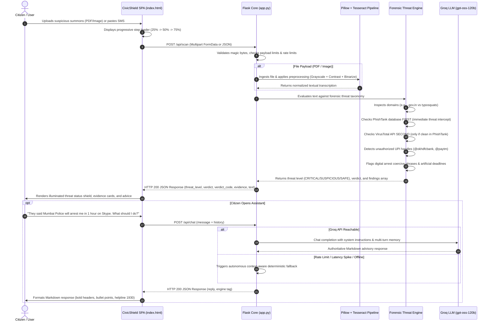

# CivicShield: AI-Powered Digital Forensics & Scam Neutralization System

<div align="center">


**An Interdisciplinary Team (IDT) Academic Cybersecurity Initiative**  
*Defending citizens against Digital Arrests, Government Impersonation, and Social Engineering Extortion.*

</div>

---

## Table of Contents

1. [Executive Summary & Problem Statement](#1-executive-summary--problem-statement)
2. [Key Capabilities & Forensic Innovations](#2-key-capabilities--forensic-innovations)
3. [System Architecture & Data Flow](#3-system-architecture--data-flow)
4. [Technology Stack](#4-technology-stack)
5. [Heuristic Forensics & Threat Taxonomy](#5-heuristic-forensics--threat-taxonomy)
6. [API Specification & Endpoints](#6-api-specification--endpoints)
7. [Installation & Local Setup](#7-installation--local-setup)
8. [Docker & Container Deployment](#8-docker--container-deployment)
9. [Cloud Deployment Guide (Render / Vercel / Railway)](#9-cloud-deployment-guide-render--vercel--railway)
10. [Threat Classification & Demonstration Test Cases (Safe vs. Malicious)](#10-threat-classification--demonstration-test-cases-safe-vs-malicious)
11. [Academic IDT Team Contributions](#11-academic-idt-team-contributions)
---

## 1. Executive Summary & Problem Statement

### The Epidemic of "Digital Arrest" & Official Impersonation Scams
In recent years, cybercrime syndicates targeting Indian citizens have shifted from rudimentary phishing to sophisticated, high-pressure psychological extortion schemes known collectively as **"Digital Arrests"** and **Government Agency Impersonation**.

According to the **Indian Cyber Crime Coordination Centre (I4C)** under the Ministry of Home Affairs (MHA), citizens have lost hundreds of crores to organized transnational fraud rings. The modus operandi involves:

1. **Intimidation via Fake Authorities**: Attackers pose as officers of the **Central Bureau of Investigation (CBI)**, **Narcotics Control Bureau (NCB)**, **Enforcement Directorate (ED)**, **Customs Department**, or state police crime branches (e.g., Mumbai Police, Delhi Police).
2. **Fabricated Digital Summons**: Victims receive forged arrest warrants, court notices bearing simulated National Emblems, or fake traffic challans.
3. **Coercive Video Confinement**: Victims are forced onto Skype, WhatsApp, or Webex video calls under the false pretense of a "Digital Arrest" and prohibited from hanging up.
4. **Financial Exfiltration**: Victims are coerced into transferring their life savings into "RBI verification accounts," "safe custody accounts," or unverified personal UPI handles under the guise of "asset verification."

### The Solution: CivicShield
**CivicShield** is an automated, real-time cyber forensic analysis platform and AI assistant built to neutralize these attacks before financial harm occurs. It provides:
- **Zero-Trust Document Verification**: Multi-pass image pre-processing and OCR extraction to detect forged seals, non-statutory threats, and hidden payloads.
- **Lookalike Phishing & Typosquatting Detection**: Real-time algorithmic checking against legitimate Indian National Top-Level Domains (`.gov.in`, `.nic.in`) and flagging of malicious URL shorteners or rogue TLDs (`.xyz`, `.vip`).
- **UPI Handle & Fraudulent VPA Interception**: Immediate flagging of personal UPI IDs inside purported official communications.
- **Resilient AI Intelligence Assistant**: Powered by the Groq LPU inference engine running `openai/gpt-oss-120b` with autonomous heuristic fallback when external networks fail.

---

## 2. Key Capabilities & Forensic Innovations

| Feature | Technical Implementation | Security Impact |
| :--- | :--- | :--- |
| **Multi-Pass OCR Pipeline** | Grayscale auto-contrast, adaptive thresholding, resolution upscaling via Pillow & Tesseract | Captures high-clarity text from blurry, low-resolution WhatsApp screenshots and noisy photographs. |
| **Typosquatting Engine** | Substring brand-token analysis, TLD whitelisting, punycode resolution, URL shortener detection | Prevents victims from navigating to clone portals mimicking Parivahan, UIDAI, Income Tax, or Delhi Police. |
| **VPA / UPI Mismatch Filter** | Regular expression parser identifying personal banking VPAs (`@okhdfcbank`, `@paytm`, `@ybl`) | Unmasks fraudulent extortion: official government bodies never collect fines via personal UPI IDs. |
| **PhishTank Threat Database** | Priority-1 local/cached community threat feed & PhishTank API verification | Intercepts verified phishing URLs instantly *before* consuming secondary API quotas. |
| **VirusTotal API Integration** | Priority-2 reputation intelligence invoked only if clean in PhishTank | Scans external domain and file hashes against 70+ security vendors. |
| **Threat Classification Engine** | Real-time multi-signal forensic evaluation with PhishTank and VirusTotal intelligence | Provides immediate Safe vs. Malicious classification with transparent forensic evidence signals. |
| **Multi-Turn Conversational AI** | Groq OpenAI-compatible Chat Completions with 131K context window & sliding memory | Empathetic, authoritative cybersecurity advisory guiding victims through Golden Hour escalation (1930 / cybercrime.gov.in). |
| **Autonomous Heuristic Fallback** | Instantaneous offline rule engine activated during API rate limits or latency spikes | Guarantees 100% platform availability even during upstream cloud outages. |

---

## 3. System Architecture & Data Flow

### Architectural Block Diagram (ASCII)

```
┌────────────────────────────────────────────────────────────────────────┐
│                       CIVICSHIELD CLIENT (SPA)                         │
│  - Vanilla JavaScript & Dark Mode CSS Design System                    │
│  - Environment-Aware Origin Resolver (Window.location.origin)          │
│  - Interactive Step-by-Step Scan Loader & Error Recovery Card          │
│  - Real-Time Markdown Chat Interface with Inline Retry Action          │
└───────────────────────────────────┬────────────────────────────────────┘
                                    │ HTTP POST (Multipart / JSON)
                                    ▼
┌────────────────────────────────────────────────────────────────────────┐
│                   ENTERPRISE FLASK BACKEND (app.py)                    │
│  - Structured CORS Engine (Configurable Origins)                       │
│  - Security Audit Logging & Request ID Tracing (UUIDv4)                │
│  - Payload Sanitization & Buffer Size Enforcement (Max 10 MB)          │
│  - Rate Limiting Middleware (Flask-Limiter / Memory / Redis)           │
└───────┬───────────────────────────┬────────────────────────────┬───────┘
        │                           │                            │
        ▼ (File Ingestion)          ▼ (Text / Chat)              ▼ (Heuristics & Threat DB)
┌───────────────────────┐   ┌───────────────────────┐   ┌───────────────────────┐
│ MULTI-PASS OCR PIPELINE│   │  GROQ LLM INFERENCE   │   │ FORENSIC THREAT ENGINE│
│ - Magic byte sniffing │   │ - openai/gpt-oss-120b │   │ - Digital arrest cues │
│ - EXIF orientation fix│   │ - 131K context window │   │ - PhishTank DB (1st)  │
│ - Grayscale & Contrast│   │ - Sliding turn window │   │ - VirusTotal API (2nd)│
│ - Adaptive binarize   │   │ - Latency resilience  │   │ - Threat Level Verdict│
│ - Tesseract OCR (Eng) │   │ - Autonomous fallback │   │ - Evidence signals    │
└───────────────────────┘   └───────────────────────┘   └───────────────────────┘
```

### End-to-End Data Flow (Mermaid)



---

## 4. Technology Stack

### Backend Core
- **Framework**: Python 3.10+ / Flask 3.x
- **Inference Engine**: Groq Cloud SDK (`groq`) using `openai/gpt-oss-120b`
- **OCR Engine**: Tesseract OCR 5.x via `pytesseract`
- **Image Processing**: Pillow (PIL) 10.x (`ImageOps`, `ImageEnhance`, `ImageFilter`)
- **PDF Extraction**: `pypdf` 4.x (with encrypted stream bypass handling)
- **Security & Hygiene**: `Flask-CORS`, `Flask-Limiter`, `werkzeug.utils`
- **WSGI Production Server**: Gunicorn 21.x

### Frontend Architecture
- **Structure**: Semantic HTML5 Single Page Application (SPA)
- **Styling**: Vanilla CSS3 Custom Properties (Dark glassmorphism, responsive grid, micro-animations)
- **Typography**: Google Fonts (`DM Sans`, `Instrument Sans`, `JetBrains Mono`)
- **Icons**: Inline scalable vector graphics (SVG) with zero external icon-font bloat
- **Markdown Engine**: Custom built-in regex parser (XSS-sanitized with zero third-party script vulnerabilities)

---

## 5. Heuristic Forensics & Threat Taxonomy

CivicShield operates an intelligence-driven, two-tier threat detection pipeline providing clear **Safe vs. Malicious classification**.

### Two-Tier Threat Intelligence Pipeline

1. **Priority 1 — PhishTank Database Check (First)**:
   - Every external URL or domain extracted from text/OCR is checked **first** against the local PhishTank intelligence feed and verification API.
   - If verified as a phishing entry, the threat is flagged as **`CRITICAL THREAT (Malicious)`** immediately and the scan pipeline proceeds without consuming secondary API quotas.
2. **Priority 2 — VirusTotal Reputation Scan (Second)**:
   - URLs that pass the PhishTank check cleanly are then passed to the VirusTotal API to cross-reference multi-vendor malware and malicious URL registries.
3. **Forensic Semantic Heuristics & UPI Interception**:
   - Evaluates high-pressure psychological manipulation cues: Digital Arrest non-bailable warrants, simulated CBI/ED/NCB interrogations, lookalike government domains, malicious APK payloads, and personal UPI virtual payment addresses (`@okhdfcbank`, `@paytm`, `@ybl`).

### Threat Classification Matrix

| Classification | Threat Level | Verdict Category | Badge Style | Trigger Criteria & System Action |
| :---: | :---: | :---: | :---: | :--- |
| **MALICIOUS** | **CRITICAL** | `CRITICAL THREAT / HIGH RISK SCAM` | `Danger (Red)` | Confirmed PhishTank phishing link, VirusTotal malicious detection, fake digital arrest warrant, lookalike government domain, malicious APK payload, or personal UPI extortion. Immediate escalation to 1930 & cybercrime.gov.in. |
| **SAFE** | **SAFE** | `LIKELY LEGITIMATE` | `Safe (Green)` | Verified official `.gov.in` / `.nic.in` domains, legitimate administrative reference numbers, or benign day-to-day communications without threat markers. |

---

## 6. API Specification & Endpoints

### 1. Health & Telemetry
- **Endpoint**: `GET /api/health`
- **Description**: Returns operational status, engine capabilities, and version metadata.
- **Response**: `200 OK`
```json
{
  "status": "healthy",
  "service": "CivicShield AI System",
  "llm_engine": "groq/openai/gpt-oss-120b",
  "llm_configured": true,
  "reasoning_effort": "medium",
  "capabilities": {
    "ocr": true,
    "pdf": true,
    "llm": true,
    "rate_limiting": true,
    "heuristic_forensics": true
  },
  "version": "4.1.0",
  "timestamp": 1792576400
}
```

---

### 2. Forensic Scan & Document Analysis
- **Endpoint**: `POST /api/scan`
- **Headers**: `Content-Type: multipart/form-data` OR `Content-Type: application/json`
- **Rate Limit**: 60 requests / hour

#### Request Formats:
**A. Multipart Form Data (File Upload):**
```
file: [binary attachment: .pdf, .png, .jpg, .jpeg, .webp, .txt]
```

**B. JSON Payload (Pasted Message):**
```json
{
  "text": "URGENT: Your Aadhaar has been blocked in connection with a money laundering case. Connect on Skype immediately or transfer Rs 50,000 security bail to cyber-verify@okhdfcbank."
}
```

#### Response (`200 OK`):
```json
{
  "verdict": "HIGH RISK — LIKELY SCAM",
  "verdict_code": "danger",
  "threat_level": "CRITICAL",
  "score": 10.0,
  "trust_score": 0.0,
  "summary": "CRITICAL THREAT SIGNALS DETECTED. This communication exhibits high-confidence indicators of government impersonation, digital arrest extortion, or lookalike phishing.",
  "findings": [
    {
      "type": "issue",
      "severity": "critical",
      "text": "PhishTank Threat Database: URL identified as active phishing infrastructure."
    },
    {
      "type": "issue",
      "severity": "high",
      "text": "Digital Arrest & Virtual Extortion: Law enforcement in India NEVER conducts 'Digital Arrests' or video-call interrogations."
    },
    {
      "type": "issue",
      "severity": "critical",
      "text": "Fraudulent UPI payment handle identified (cyber-verify@okhdfcbank). Official law enforcement and ministries NEVER collect fines, bails, or penalties via personal UPI VPAs."
    }
  ],
  "threat_tags": [
    "phishtank_phish",
    "digital_arrest",
    "fake_legal_coercion",
    "urgent_financial_coercion",
    "upi_payment_trap"
  ],
  "extracted_text": "URGENT: Your Aadhaar has been blocked..."
}
```

---

### 3. Cyber Intelligence Assistant Chat
- **Endpoint**: `POST /api/chat`
- **Headers**: `Content-Type: application/json`
- **Rate Limit**: 120 requests / hour

#### Request Format:
```json
{
  "message": "Someone claiming to be from Mumbai Cyber Cell called me about illegal narcotics in a FedEx package. What should I do?",
  "history": [
    { "role": "user", "content": "Hello, I got a call from an unknown officer." },
    { "role": "assistant", "content": "I can help verify official communications. What details did they provide?" }
  ]
}
```

#### Response (`200 OK`):
```json
{
  "reply": "### Advisory: Courier & Narcotics Impersonation Scam\n\n**Verdict**: HIGH-RISK IMPERSONATION SCHEME.\n\n**Modus Operandi**:\nFraudsters pose as FedEx or DHL customer support stating that a package containing contraband has been intercepted, then connect you to a fake police officer demanding money.\n\n**Recommended Steps**:\n1. **Do not pay any fee or penalty**.\n2. Contact your local police station or dial **1930** immediately.\n3. File an official complaint on **cybercrime.gov.in**.",
  "engine": "groq/openai/gpt-oss-120b",
  "status": "success",
  "fallback_reason": null,
  "request_id": "8a4f91b2"
}
```

---

### 4. HTTP Error Catalog

| Status Code | Error Message | Solution / Cause |
| :---: | :--- | :--- |
| `400 Bad Request` | `Missing or empty 'text' parameter in JSON payload.` | Ensure either a valid file or non-empty text string is provided. |
| `413 Payload Too Large` | `Payload exceeds maximum permissible size (10 MB).` | Compress PDF or downsample image resolution below 10 MB. |
| `422 Unprocessable` | `Unable to extract legible text from this file.` | The uploaded image is too blurry, unreadable, or missing OCR data. |
| `429 Rate Limited` | `Rate limit exceeded. Please wait a moment.` | Exceeded quota (60 scans/hr, 120 chats/hr). Retry after cooldown. |
| `500 Server Error` | `Internal computation fault. Please retry.` | Handled internal exception logged with unique `X-Request-ID`. |

---

## 7. Installation & Local Setup

### Prerequisites
- **Python 3.10** or higher
- **Git**
- **Tesseract OCR**:
  - **Windows**: Download the official installer from [UB-Mannheim Tesseract](https://github.com/UB-Mannheim/tesseract/wiki). Ensure it is installed to `C:\Program Files\Tesseract-OCR\tesseract.exe`.
  - **Ubuntu / Debian**:
    ```bash
    sudo apt-get update && sudo apt-get install -y tesseract-ocr tesseract-ocr-eng
    ```
  - **macOS (Homebrew)**:
    ```bash
    brew install tesseract
    ```

### Step 1: Clone the Repository
```bash
git clone https://github.com/cyber-pranav/CivicShield.git
cd CivicShield
```

### Step 2: Create and Activate Virtual Environment
```bash
# Linux / macOS:
python3 -m venv venv
source venv/bin/activate

# Windows (Command Prompt):
python -m venv venv
venv\Scripts\activate.bat

# Windows (PowerShell):
python -m venv venv
venv\Scripts\Activate.ps1
```

### Step 3: Install Dependencies
```bash
pip install --upgrade pip
pip install -r requirements.txt
```

### Step 4: Configure Environment Variables
Copy the template configuration file:
```bash
cp .env.example .env
```
Open `.env` and configure your credentials:
```ini
SECRET_KEY=generate_a_random_secret_string
GROQ_API_KEY=gsk_your_groq_api_key_here
GROQ_MODEL=openai/gpt-oss-120b
PORT=5000
FLASK_DEBUG=false

# Windows only (if tesseract is not in system PATH):
# TESSERACT_CMD=C:\Program Files\Tesseract-OCR\tesseract.exe
```

### Step 5: Start the Server
```bash
python app.py
```
Open your browser and navigate to:
```
http://localhost:5000
```

---

## 8. Docker & Container Deployment

CivicShield comes complete with a hardened multi-stage Docker setup and `docker-compose.yml`.

### Single-Command Run with Docker Compose
```bash
# Build and spin up container in detached mode
docker compose up -d --build
```
Inspect logs:
```bash
docker compose logs -f
```
Access the application at `http://localhost:5000`.

### Manual Docker Build
```bash
# Build production image
docker build -t civicshield:latest .

# Run with environment variables
docker run -d --name civicshield-app \
  -p 5000:5000 \
  --env-file .env \
  civicshield:latest
```

---

## 9. Cloud Deployment Guide (Render / Vercel / Railway)

### Deploying on Render (Recommended)
1. Fork or push this repository to GitHub.
2. Sign in to [Render](https://render.com) and click **New + > Web Service**.
3. Select your `CivicShield` repository.
4. Configure service settings:
   - **Environment**: `Docker`
   - **Branch**: `main`
   - **Region**: Singapore / Frankfurt / Oregon
   - **Plan**: Free or Starter
5. Add the Environment Variables:
   - `GROQ_API_KEY` = your Groq API key
   - `GROQ_MODEL` = `openai/gpt-oss-120b`
   - `GROQ_REASONING_EFFORT` = `medium`
   - `SECRET_KEY` = long random cryptographic string
   - `FLASK_DEBUG` = `false`
6. Click **Create Web Service**. Render will automatically build the `Dockerfile` with Tesseract OCR pre-installed and start Gunicorn.

---

## 10. Threat Classification & Demonstration Test Cases (Safe vs. Malicious)

For academic viva demonstrations, defense juries, and faculty evaluations, CivicShield features a verified **Safe vs. Malicious Threat Classification**. By combining PhishTank (Priority 1) and VirusTotal (Priority 2) with forensic pattern recognition, the platform provides clear, unambiguous verdicts with transparent forensic evidence.

---

### Safe Section (Verified Legitimate)

These test cases demonstrate authentic, non-threatening communications that are verified safe by the platform:

| Category | Input Scenario | Verification Findings & Rationale | Status |
| :--- | :--- | :--- | :---: |
| **Official Government Portal** | `https://incometax.gov.in Reference No: IT/2026/8941` | Valid `.gov.in` domain + formal administrative filing syntax. Whitelisted as authoritative government infrastructure. | **SAFE** |
| **National Ministry Domain** | `https://parivahan.gov.in` | Verified legitimate Indian government transport portal (`.gov.in` / `.nic.in`) whitelisted directly. | **SAFE** |
| **Everyday Benign Communication** | `Meeting scheduled with municipal road repair team next Monday at city center.` | Everyday non-coercive text without urgency, extortion, threat keywords, or external malicious links. | **SAFE** |
| **Official Tax Processing Notice** | `Dear Taxpayer, Your Income Tax Return for AY 2025-26 has been successfully processed. No further action is required from your end. Regards, Income Tax Department. https://incometax.gov.in` | Verified legitimate `.gov.in` domain with standard non-coercive informational wording. | **SAFE** |

---

### Malicious Section (Critical Threats & Scams)

These test cases demonstrate fraudulent, coercive, and phishing attacks intercepted and neutralized by the platform:

| Attack Category | Threat Scenario | Primary Detection Signals | Status |
| :--- | :--- | :--- | :---: |
| **PhishTank Confirmed Threat** | `https://phishtank.icu/login` | Intercepted directly by PhishTank Threat Database as Priority 1 active phishing infrastructure. | **MALICIOUS** |
| **Digital Arrest Extortion** | `Digital arrest order: CBI NBW issued. Transfer Rs 98,000 bail deposit to rbi-clearing@okhdfcbank or https://court-bail.icu/pay now` | Digital Arrest NBW coercion + personal UPI VPA extortion (`@okhdfcbank`) + disposable `.icu` phishing link. | **MALICIOUS** |
| **Law Enforcement Video Trap** | `CBI arrest warrant issued against your Aadhaar. Connect immediately on video call: https://cbi-investigation.top/case` | Coercive legal threat: simulated CBI warrant, Aadhaar misuse, video call confinement, and malicious `.top` TLD. | **MALICIOUS** |
| **Courier Narcotics Extortion** | `FedEx: Your parcel containing narcotics and illegal passports has been confiscated by customs police. Pay penalty immediately.` | Parcel interception trap, narcotics seizure threat, and fraudulent immediate penalty demand. | **MALICIOUS** |
| **Aadhaar Suspension / KYC Bait** | `URGENT: Your Aadhaar will be blocked in 2 hours. Pay Rs.499 penalty immediately to avoid arrest. Click: http://fake-gov-india.com/verify` | Lookalike government domain (`fake-gov-india.com`) + coercive panic deadline + penalty extortion. | **MALICIOUS** |
| **Malicious APK Payload Delivery** | `Urgent KYC alert: install and download our banking update app.apk immediately to prevent account suspension.` | Sideloaded APK payload request designed to steal SMS OTPs and banking credentials. | **MALICIOUS** |
| **Direct IP Address Hosting** | `http://192.168.1.1/verify` | Direct numeric IPv4 hostname bypassing standard DNS reputation and domain security controls. | **MALICIOUS** |

---

### Quick Copy-Paste Test Inputs for Faculty Review

Use the following test snippets during live project evaluation to demonstrate the Safe and Malicious classification:

#### Safe Test Scenarios

##### Test 1: Verified Official Government Notice
```text
https://incometax.gov.in Reference No: IT/2026/8941
```
*Expected Result:* Threat Level **SAFE**, Verdict: **Verified low risk / Legitimate**, Findings report official government domain verification and formal filing syntax.

##### Test 2: Standard Official Portal
```text
https://parivahan.gov.in
```
*Expected Result:* Threat Level **SAFE**, Verdict: **Verified low risk / Legitimate**, Confirms official `.gov.in` whitelist status.

##### Test 3: Clean Benign Message
```text
Meeting scheduled with municipal road repair team next Monday at city center.
```
*Expected Result:* Threat Level **SAFE**, Verdict: **Verified low risk / Legitimate**, Zero threat tags detected.

---

#### Malicious Test Scenarios

##### Test 4: PhishTank Database Interception
```text
https://phishtank.icu/login
```
*Expected Result:* Threat Level **CRITICAL**, Verdict: **Malicious — PhishTank Confirmed Phishing**, Intercepted directly by PhishTank Threat Database as Priority 1 threat.

##### Test 5: Law Enforcement Impersonation & Arrest Threat
```text
CBI arrest warrant issued against your Aadhaar. Connect immediately on video call: https://cbi-investigation.top/case
```
*Expected Result:* Threat Level **CRITICAL**, Verdict: **Malicious — High Risk Scam**, Detects fake CBI warrant, coercive video call demand, and malicious `.top` TLD.

##### Test 6: Digital Arrest & UPI Extortion Trap
```text
Digital arrest order: CBI NBW issued. Transfer Rs 98,000 bail deposit to rbi-clearing@okhdfcbank or https://court-bail.icu/pay now
```
*Expected Result:* Threat Level **CRITICAL**, Verdict: **Malicious — High Risk Scam**, Flags digital arrest extortion, fraudulent personal UPI VPA (`@okhdfcbank`), and disposable `.icu` link.

##### Test 7: Fake Aadhaar Block & Spoofed Domain
```text
URGENT: Your Aadhaar will be blocked in 2 hours. Pay Rs.499 penalty immediately to avoid arrest. Click: http://fake-gov-india.com/verify
```
*Expected Result:* Threat Level **CRITICAL**, Verdict: **Malicious — High Risk Scam**, Flags typosquatting government domain, coercive deadline, and penalty extortion.

##### Test 8: Malicious APK Application Trap
```text
Urgent KYC alert: install and download our banking update app.apk immediately to prevent account suspension.
```
*Expected Result:* Threat Level **CRITICAL**, Verdict: **Malicious — High Risk Scam**, Flags malicious APK download trap targeting mobile banking credentials.

---

<div align="center">

**CivicShield — Empowering Citizens with Autonomous Cybersecurity Intelligence.**  
*National Cyber Crime Reporting Helpline: 1930 | Portal: cybercrime.gov.in*

## 11. Academic IDT Team Contributions

This capstone project was conceived and engineered by an Interdisciplinary Team (IDT), combining Cybersecurity Forensics, Applied Artificial Intelligence, and Modern Full-Stack Software Engineering.

| Team Member | Project Role & Core Responsibilities |
| :--- | :--- |
| **Krishsinh Raj** | **Team Leader & Cybersecurity Architect**<br>• Designed the heuristic threat taxonomy and Safe vs. Malicious classification logic.<br>• Engineered the typosquatting, government impersonation, and UPI extortion detection rules. |
| **Naishal Nadiya** | **Technical Lead & AI Integration**<br>• Implemented the Groq `gpt-oss-120b` LLM inference engine.<br>• Designed the multi-turn conversational memory and deterministic fallback system. |
| **Diya Patel** | **UI/UX Engineer & Frontend Development**<br>• Designed the responsive, dark-mode Single Page Application (SPA).<br>• Developed the animated risk status shield, glassmorphic UI, and interactive scan progression. |
| **Ansh Dohare** | **Computer Vision & DevOps**<br>• Built the multi-pass Pillow image enhancement pipeline (grayscale, contrast, binarization).<br>• Integrated Tesseract OCR and managed Docker containerization strategies. |
| **Pranav Pandya** | **Backend API & Data Processing**<br>• Developed the enterprise Flask server and secure routing protocols.<br>• Handled payload sanitization, file-type verification, and VirusTotal/PhishTank API integrations. |

</div>

